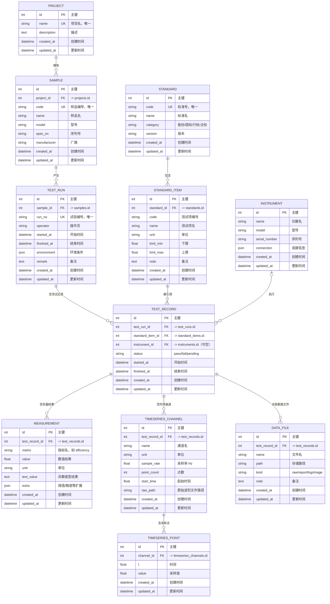

# 阶段 3 · 分层架构落地（接入你的测试框架）★核心

> 这是把「数据库能力」真正**接进你 12 万行测试架构**的阶段。
> 核心不是写 SQL，而是建立「代码与逻辑分离」的分层，让后续维护、扩展都省心。

## 本章目标
- 理解 Repository（数据访问）、Service（业务）、Schema（边界）三层的职责与依赖方向。
- 会写一个 pytest fixture 管理数据库生命周期，把「测试结果写入数据库」接入现有用例。
- 会用 Pydantic 在边界做入参校验和出参序列化。

## 对应代码位置

本章要通读骨架**全部**代码（它们就是分层架构的完整示例）：

| 层 | 文件 | 你要重点看 |
| --- | --- | --- |
| core | `powerdb/core/engine.py` | `session_scope` 事务、`create_schema` |
| models | `powerdb/models/*.py` | 表结构（上阶段已读过） |
| repositories | `powerdb/repositories/base.py` | 通用 CRUD 基类 |
| repositories | `powerdb/repositories/result_repository.py` | 复杂 JOIN 查询（横向对比） |
| repositories | `powerdb/repositories/timeseries_repository.py` | 批量写入 |
| services | `powerdb/services/comparison_service.py` | 业务编排、统计 |
| services | `powerdb/services/timeseries_service.py` | 时序业务 |
| schemas | `powerdb/schemas/*.py` | Pydantic 边界模型 |

## 基础知识详解

### 1. 为什么分层？（代码与逻辑分离）
- **不分层**的问题：Pytest 用例、归档脚本、看板到处手写 SQL → 一个字段改名要在 N 处改，逻辑散落难维护。
- **分层**后：SQL 只待在 `repositories`，业务规则只待在 `services`，调用方只见「有语义的方法名」（如 `compare_metric`）。

### 2. Repository 模式（数据访问层）
把所有数据库读写收口到一个类里（继承 `Repository` 基类）。复杂查询也写在这里，方法名表达意图：
```python
class MeasurementRepository(Repository[Measurement]):
    model = Measurement
    def query_for_comparison(self, *, metric, sample_id=None, standard_item_id=None) -> list[dict]:
        ...  # 多表 JOIN，返回稳定结构的 dict 列表
```

### 3. Service 层（业务逻辑）
只做「编排」：开一个 `session_scope`、调 Repository、把结果加工成看板/AI 要的形态。**不写 SQL**。
```python
def compare_metric(metric, *, sample_id=None, as_dataframe=False):
    with session_scope() as session:
        rows = MeasurementRepository(session).query_for_comparison(metric=metric, sample_id=sample_id)
    return pd.DataFrame(rows) if as_dataframe else rows
```

### 4. Schema 层（Pydantic 边界）
入参用 `...Create` 校验，出参用 `...Out` 序列化。这层保证了**看板/AI/API 拿到的结构稳定**。

### 5. `session_scope` 事务上下文
业务代码永远不手动 `commit/close`，交由 `session_scope` 统一管理（正常提交、异常回滚、最终关闭）。

## 表关系一览（ER 图）

`powerdb/models/` 下所有模块联合起来，就是一张完整的「项目 → 样品 → 试验 → 记录 → 结果」关系网。
下图用 Mermaid `erDiagram` 描述所有表及其外键关系（GitHub / VS Code 预览可直接渲染）。

各实体对应的模块文件：

| 实体（表） | 来源模块 | 说明 |
| --- | --- | --- |
| PROJECT / SAMPLE | `models/project.py` | 项目、被测样品 |
| STANDARD / STANDARD_ITEM | `models/standard.py` | 标准、标准测试项 |
| INSTRUMENT | `models/instrument.py` | 仪器仪表 |
| TEST_RUN / TEST_RECORD | `models/test_run.py` | 试验批次、单条测试记录 |
| MEASUREMENT | `models/result.py` | 标量测量结果 |
| TIMESERIES_CHANNEL / TIMESERIES_POINT | `models/timeseries.py` | 时序通道、采样点 |
| DATA_FILE | `models/data_file.py` | 关联数据文件 |



**一句话记住整条外键链**（自上而下，删父前要先处理子）：

```
PROJECT → SAMPLE → TEST_RUN → TEST_RECORD → MEASUREMENT
                                          ├─ TIMESERIES_CHANNEL → TIMESERIES_POINT
                                          └─ DATA_FILE
STANDARD → STANDARD_ITEM ─────────────────┘（被 TEST_RECORD 引用）
INSTRUMENT ───────────────────────────────┘（TEST_RECORD 可选引用）
```

> 三个「顶层表」`PROJECT` / `STANDARD` / `INSTRUMENT` 没有任何外键，可以独立增删改；
> 其余表都靠 `*_id` 外键挂在它们下面，这就是「越往下依赖越深」的原因。

## 训练 Demo 详解

**任务一（读）**：从 `examples/seed_demo.py` 出发，追一条数据完整经过哪些层：
```
seed_demo 调 session.add(Measurement(...))          -> models
seed_demo 调 compare_metric("efficiency")           -> service -> repository -> models
```
画出「调用方 → service → repository → model」的链路。

**任务二（跑）**：
```bash
cd /workspace/powerdb
python3 -m pytest -q        # 看 3 个用例如何用 fixture 隔离数据库
```
打开 `tests/test_basic.py` 和 `tests/test_comparison.py`，指出：
- fixture 里 `init_engine(DatabaseConfig(url=...))` + `create_schema(drop=True)` 做了什么；
- 断言如何验证「写入→读回」。

**任务三（接入你的真实业务）**：在你现有某个测试用例的 teardown/report 阶段：
```python
with session_scope() as s:
    s.add(Measurement(test_record_id=rec_id, metric="efficiency", value=result, unit="%"))
```
先跑通 1 个指标，再逐步扩大到整条试验。

**验证标准**：真实测试项跑完后，结果能被一段 Service 代码查询回来。

## 官方文档链接
- SQLAlchemy ORM 映射风格：https://docs.sqlalchemy.org/en/20/orm/mapping_styles.html
- 关系 relationship：https://docs.sqlalchemy.org/en/20/orm/relationships.html
- 查询（Select）：https://docs.sqlalchemy.org/en/20/orm/queryguide/select.html
- Pydantic 官方文档：https://docs.pydantic.dev/latest/
- Pytest fixture：https://docs.pytest.org/en/stable/how-to/fixtures.html

## 学习笔记

### 日常踩坑记录（Pitfalls）
| 日期 | 现象/问题 | 原因 | 解决/结论 |
| --- | --- | --- | --- |
| 示例 | 跨 session 访问对象报 `DetachedInstanceError` | 对象脱离了原 session | 在依赖它的 session 内访问或用 `expire_on_commit=False` |
| 示例 | `add` 后拿不到 `obj.id` | 还没 `flush`/`commit`，主键未生成 | 需要 id 时先 `session.flush()` |
|  |  |  |  |

### 学习待办（Todo）
- [ ] 画出「调用方→service→repository→model」链路图
- [ ] 跑通 `pytest` 并讲清 fixture 的隔离逻辑
- [ ] 把 1 个真实测试指标写入数据库并查回